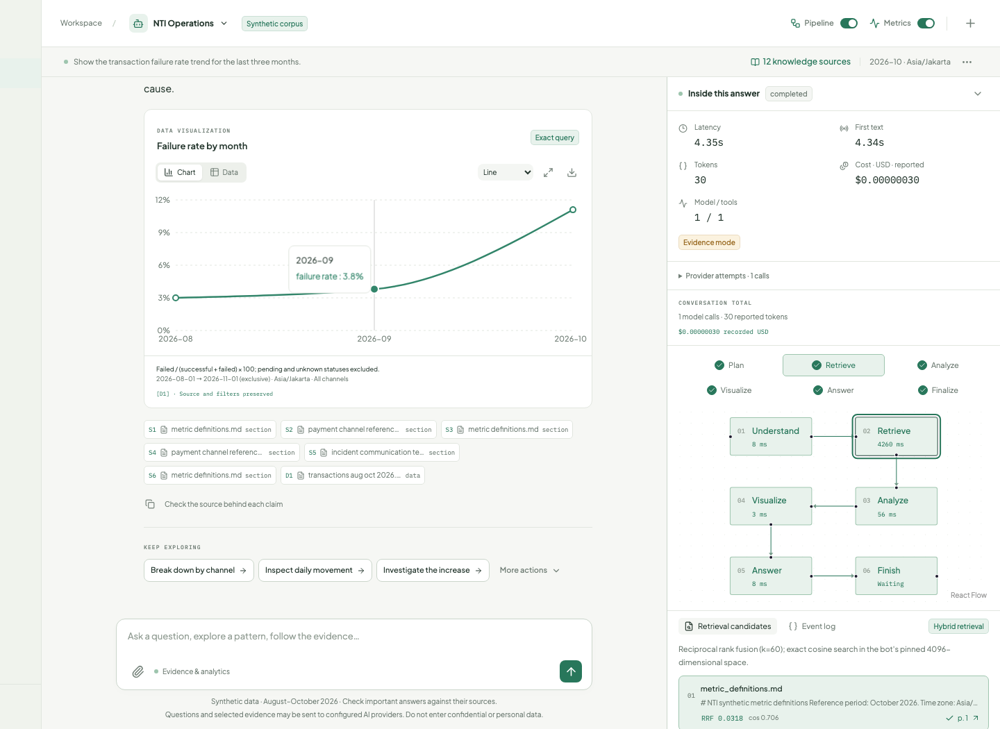
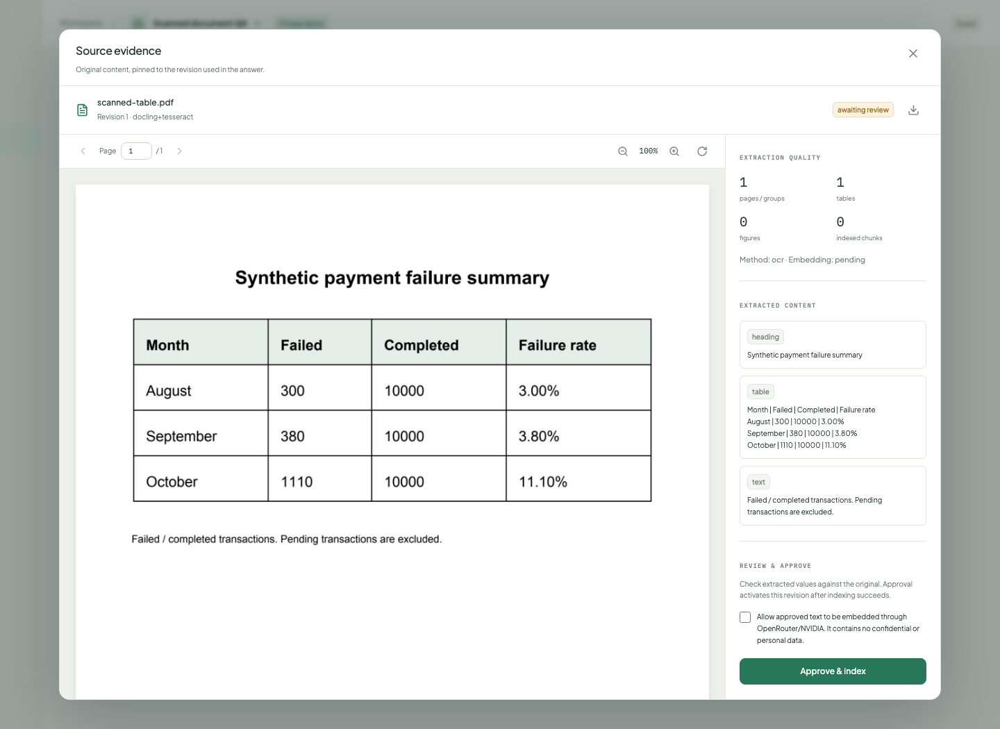

# Tampak-Chat

A document and analytics chatbot workspace with visible workings. Built for the NTI AI Engineer technical test and a portfolio deployment.

**Review deployment:** [chat.tampak.my.id](https://chat.tampak.my.id). Sign in using credentials shared by the owner; the deployed workspace does not allow anonymous sessions.

- **Exact analytics:** typed, read-only dataset queries calculate rates, trends, period comparisons and contribution to an increase, with charts and inspectable source records.
- **Configurable document processing:** native extraction, Docling layout reconstruction, OCR and vision preserve tables, figures and source locations through reviewed document revisions.
- **Transparent RAG and observability:** follow retrieval rankings and tools, open highlighted evidence, and watch latency, token estimates and USD cost reconcile through durable SSE.

The approved **Focus** interface has a compact sidebar that expands on hover or keyboard focus, with a separate touch toggle. Pipeline and Metrics are independent controls in a right-hand panel on wide screens; at 1100 px and below they move beneath the chat. Charts, follow-up actions and citations work with both controls off. Each chatbot retrieves only its own knowledge; composer attachments are private to their conversation.

Exact analytics with the execution inspector:



Document processing with reviewed OCR and reconstructed table content:



## Run locally

Requirements: Docker, Node.js 24, Corepack/pnpm, uv and Python 3.12. uv installs the project’s Python version when needed. Local OCR also needs Tesseract with English and Indonesian language data; the backend container includes both.

```sh
# macOS, when OCR is not installed
HOMEBREW_NO_AUTO_UPDATE=1 brew install tesseract tesseract-lang

corepack enable
python3 scripts/local.py up
```

Open **[localhost:3010](http://localhost:3010)**. API documentation is at **[localhost:8100/api/docs](http://localhost:8100/api/docs)**.

The command creates a private `.env`, starts the isolated PostgreSQL service, installs locked dependencies, applies migrations, seeds NTI Operations, prepares Docling models, builds the production web app and starts the API and workers. First-time model downloads take longer than subsequent starts. It preserves existing secrets, bots and conversations.

```sh
python3 scripts/local.py status
python3 scripts/local.py down
python3 scripts/local.py up --dev  # frontend hot reload
python3 scripts/local.py prepare-ocr
```

Stop the app before rebuilding or switching run modes. Logs are in `runtime/logs/`. `down` preserves the PostgreSQL container and persistent volume; `docker compose stop postgres` also stops the database.

| Service | Local address |
| --- | --- |
| Web | `http://localhost:3010` |
| API | `http://127.0.0.1:8100` |
| PostgreSQL | `127.0.0.1:55434` |
| Chat and ingestion workers | No public ports |

These ports and the `tampak-chat` Compose project are separate from other applications on the machine.

## Configure real AI

The app opens without an API key. **Evidence mode** computes exact dataset results and returns retrieved source excerpts. It is labeled in the chat and trace. Missing embeddings show **ready lexical / embedding key needed**. This mode does not simulate an LLM, OCR completion or successful vector indexing.

1. Open **Admin settings** and sign in. Initial `TAMPAK_ADMIN_USERNAME` and `TAMPAK_ADMIN_PASSWORD` are in the private root `.env`; bootstrap never prints them.
2. Set the Chat provider’s OpenAI-compatible base URL, key and model. Load its model catalog or enter an identifier manually. Configure token pricing, context/output limits and public demo access; save and test it.
3. Configure Vision separately to enable image interpretation, figure descriptions and full-page vision extraction. Enable the Image input capability and test the saved configuration.
4. Add an OpenRouter key to Embedding. The model is pinned to `qwen/qwen3-embedding-8b`, with 4,096 dimensions and exact cosine search. Run the query/document relevance probe. Requests cap provider input pricing at $0.01 per million tokens.
5. In **Knowledge**, open each approved source and enable vector indexing. Existing lexical sources stay usable while setup is incomplete.

The selected [Qwen3 embedding endpoint](https://openrouter.ai/qwen/qwen3-embedding-8b) is a low-cost paid model. The owner approved this replacement after Nemotron's free daily quota was exhausted. The complete NTI index was rebuilt under a new model/query-format fingerprint; vectors from different spaces are never mixed. Upload and approval controls disclose remote processing. Share only material you may send to the configured providers.

Prices are USD per **one million tokens**. Streaming estimates are labeled and reconciled with provider usage. Missing usage or price remains unavailable. The usage ledger includes planning, embeddings, vision, answer generation and failed attempts. Global and per-guest budget reservations run before calls. Provider charges are separate from infrastructure cost.

OpenRouter profiles expose a reasoning control in Admin. New chat profiles default to reasoning off and a 4,096-token output allowance. Reasoning can share that allowance with answer text. Empty completions and output-limit truncation are explicit failures; partial text and billed usage remain visible, and retry creates a new run. The ledger records finish reason, visible character count and reported reasoning-token count without storing private reasoning text.

To change the admin password without putting it in shell history:

```sh
uv run --directory services/backend python -m app.cli admin-password
```

This revokes existing admin sessions. Changing the initial password in `.env` after bootstrap does not rotate the stored password. Preserve `TAMPAK_MASTER_KEY` when moving or restoring the database; it encrypts stored provider keys.

## Try the technical-test demo

NTI Operations is immediately seeded with fictional data:

- 30,180 transaction records: 10,000 completed and 60 pending in each of August, September and October 2026.
- Eleven documents plus the transaction dataset: four PDFs totaling 60 pages, two DOCX references and five Markdown guides, with about 11,000 document words and 109 indexed chunks.
- The original incident report and playbook are expanded to 32 and 16 pages. Additional documents cover gateway integration, transaction states, routing/failover, reconciliation, data imports, incident communications and reliability review.
- Reproducible failure rates of **3.00%, 3.80% and 11.10%**. October E-wallet failures are **648 / 4,000 = 16.20%**. E-wallet accounts for **548 / 730 = 75.07%** of the increase in failures versus September.

Suggested walkthrough:

1. Ask for the three-month failure-rate trend. Switch the chart to Data and inspect the denominator.
2. Use **Break down by channel**. The follow-up preserves the originating dataset, period and filters.
3. Ask which channel contributed most to October’s increase, or compare October with September. Distinguish a rate, a percentage-point change and a contribution.
4. Open an incident-report citation. The viewer opens the pinned revision, including the page-7 finding, and highlights parser-derived regions.
5. Ask for the gateway-timeout response procedure as a diagram. Use **Explain the evidence** to inspect what it establishes and what remains uncertain; this action keeps the original answer's exact document chunks and citations.
6. Turn Pipeline and Metrics off, then open a source or chart. Those answer features remain available.
7. Create a private temporary chatbot, upload a source, select its processing method, review extraction and approve it. Attachments added from the composer stay private to that conversation.

See the [complete corpus inventory and example questions](docs/SEED_CORPUS.md). The seed’s reference month is October 2026 and its time zone is Asia/Jakarta. A new chatbot can use a different reference month. Ordinary startup is idempotent and preserves existing corpora. To explicitly upgrade an older installation to the expanded packaged NTI corpus and index it using the saved embedding configuration:

```sh
uv run --directory services/backend python -m app.cli refresh-seed
# Full Docker mode: docker compose exec -T api python -m app.cli refresh-seed
```

This creates immutable revisions for changed packaged files, preserves older citations and leaves other chatbots untouched. Repeating it reuses the same corpus version and compatible completed embeddings. The numerical CSV stays unchanged. Ingestion batches up to 12 chunks; `TAMPAK_EMBEDDING_BATCH_SIZE` (1–12) and `TAMPAK_EMBEDDING_INTERVAL_SECONDS` control batching and pacing. A changed model/query-format fingerprint forces re-embedding even when text and dimensions are unchanged.

If provider quota is exhausted, `refresh-seed --defer-embeddings` publishes reviewed lexical sources while retaining completed vectors. Run `refresh-seed` again after restoring quota to finish the missing vectors. Known query-embedding rate limits are shown explicitly in the inspector and use scoped lexical retrieval.

## Documents and datasets

Uploads support PDF, DOCX, TXT, Markdown, CSV, XLSX, PNG, JPEG and WebP. Automatic processing uses Docling layout/OCR for PDFs and images and native structured parsers for Office, text and datasets. Alternatives are fast native extraction, layout/OCR, forced OCR and configured full-page vision. Per-file controls include page range, OCR language, table accuracy, figure interpretation, chunking and a remote processing budget.

Originals, table structure, figure crops and page/section provenance are retained. Generated interpretations are labeled. Tables repeat their headers across row chunks. A preview is reviewed before publication; replacement and reprocessing create a new revision. Failed replacements preserve the last active version. Native DOCX/text use structural anchors; page-only provenance has an explicit fallback instead of fabricated geometry.

Chatbot knowledge is managed from **Knowledge** and is automatically available to its conversations. The chat attachment tray contains only files uploaded inside that conversation. Removing an attachment preserves the chatbot's permanent corpus; the chat header shows the number of active knowledge sources.

CSV/XLSX profiling exposes a sample and semantic mappings for timestamps, status, channel and amount. XLSX imports the active worksheet. Confirm the mapping before approval. Numeric questions use a constrained, read-only DuckDB tool over private Parquet; transaction totals are never approximated by retrieving a few vectorized rows. Dataset citations can inspect records matching the saved period and channel filters.

## Streaming and recovery

The browser submits a run and subscribes to SSE. A leased worker owns the work. Closing the browser connection or leaving the chat does **not** cancel it.

Messages and events are persisted before delivery. Opening a conversation obtains an atomic snapshot and event cursor, then replays later events. Event IDs prevent repeated text and usage. Explicit Stop preserves a marked partial answer. Worker loss produces an interrupted run and retains partial output; retry starts a new run, since repeating an uncertain provider request could repeat its charge.

## Stack and boundaries

| Layer | Implementation |
| --- | --- |
| Interface | Next.js, React, TypeScript, assistant-ui external store, Radix controls |
| Visualizations | Recharts, React Flow, validated Mermaid specifications and sanitized SVG |
| API and orchestration | FastAPI, LangGraph, LangChain text splitters, compatible HTTP streaming transport |
| Persistence | PostgreSQL/pgvector, Psycopg, forced row-level policies, private filesystem artifacts |
| Extraction | Docling, Tesseract, pdfplumber/PDFium, python-docx, Pillow |
| Analytics | Typed plans, DuckDB, Parquet, OpenPyXL |
| Execution | Separate chat/ingestion workers, PostgreSQL leases, durable events and cancellation |

Runtime database access uses a non-superuser role. Migration credentials are confined to Compose’s setup service. Guest sessions use opaque HttpOnly cookies and CSRF protection. Provider keys are encrypted and excluded from public responses. Guests cannot browse another session’s bots, conversations, attachments, source previews or runs. Admin run history exposes operational metadata rather than private questions.

Guest defaults: three bots, five knowledge sources per bot or attachments per conversation, 10 MB per file, 50 MB total storage, 100 extracted pages, 30 daily chat turns, 120 daily provider calls, token limits and two simultaneous answers. Demo data expires after 24 hours. The sidebar shows remaining quota and expiry. Cleanup revokes access and removes originals and derivatives.

## Docker-only local deployment

```sh
python3 scripts/bootstrap.py
docker compose up --build -d
docker compose ps
```

Stop native local processes first to release ports 3010 and 8100. Compose runs setup, PostgreSQL, API, two worker services and the standalone web build. OCR weights persist in the shared data directory. Linux uses CPU PyTorch wheels. The backend runs as a non-root user and the ingestion container has CPU, memory and process limits.

The VPS runs a separate production Compose project behind the existing Caddy proxy. GitHub Actions verifies changes, builds Linux images and deploys immutable digests through a dedicated restricted SSH key. HTTPS, required admin login and real SSE reconnection have passed on the public domain. The 12-source/109-vector seed and encrypted model profiles are available there; local conversation history was not transferred. See [VPS deployment and operations](docs/DEPLOYMENT.md). Off-host backups, a full restore drill, load testing and a stronger parser sandbox for untrusted public uploads remain later operations.

## Verify

Start PostgreSQL before backend tests. They create a disposable database, key-free API/workers and private artifacts, then remove them; they do not use saved application data or provider keys. Start the local application for browser checks.

```sh
pnpm typecheck
pnpm lint
pnpm format:check
pnpm test:backend
pnpm exec playwright install chromium
pnpm test:e2e
pnpm test:sse
pnpm test:processing
pnpm test:analytics
```

The browser recovery test uses an explicitly labeled transport fixture; it never substitutes a mock provider for real application answers. HTTP provider mocks are confined to tests. Qwen relevance and full NTI indexing have been live-verified: all 109 chunks across 12 sources are ready, and OpenRouter reported $0.00015717 for 15,717 indexing tokens. Live Chat streaming and an evidence-grounded follow-up passed with reported usage and cost. Vision input still needs a live probe. See the verification report for the limits of these checks.

Planning and verification: [PRD](docs/PRD.md), [technical design](docs/TECHNICAL_DESIGN.md), [approved UI direction](docs/design/DESIGN_PROPOSAL.md), [implementation status](docs/IMPLEMENTATION_STATUS.md), [verification results](docs/VERIFICATION.md).
