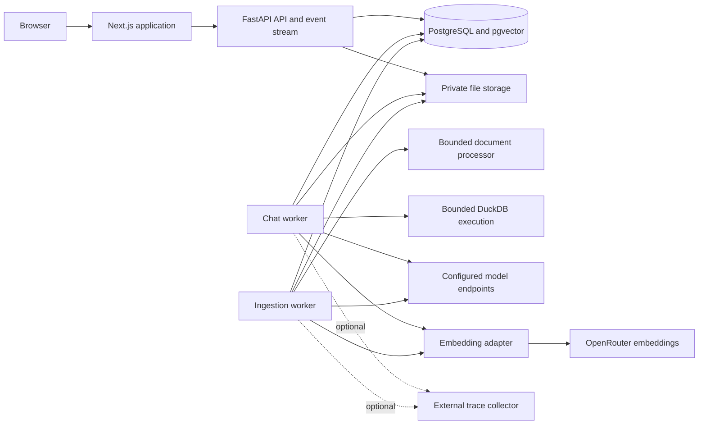

# Tampak-Chat Technical Design

Version 0.6 · 4 November 2026 · Target full local application today in Asia/Jakarta

Tampak-Chat will use a React application and a modular Python backend. LangGraph coordinates explicit retrieval and analytics steps; LangChain supplies model, embedding, and document interfaces. PostgreSQL stores application state, vectors, jobs, and execution events. Rich document extraction runs outside HTTP requests and produces a versioned, inspectable representation before indexing.

The design supports anonymous temporary chatbots and an authenticated admin without introducing a managed cloud dependency. Local operation is the current deliverable. The same application can later run behind HTTPS on the supplied VPS.

This document records the architecture and original implementation plan. The local application now exists; [implementation status](IMPLEMENTATION_STATUS.md) records decisions that narrowed or changed planned details, and [verification](VERIFICATION.md) records actual evidence. Planned benchmarks and live integrations are not implicitly verified by this design. [The PRD](PRD.md) defines product behavior. Supporting research covers [UI foundations](research/UI_AND_CHAT_HARNESSES.md) and [document processing](research/DOCUMENT_PROCESSING.md).

## 1 Architectural decisions

| Area | Recommended choice | Reason and boundary |
| --- | --- | --- |
| Web application | Next.js, React, TypeScript | Established application shell, routing, and template ecosystem |
| UI foundation | assistant-ui Thread and Sidebar; shadcn/ui controls | Reuse existing chat behavior and accessible primitives |
| Pipeline inspector | Free React Flow UI components with a fixed stage graph | Inspect execution; no workflow-authoring product to build |
| Visual chat answers | shadcn/ui chart components using Recharts, plus Mermaid diagrams | Render validated, persisted chart and diagram blocks directly in messages |
| Web state | Server-state query cache plus one typed event reducer | Avoid separate inconsistent stores for chat, graph, and metrics |
| API | FastAPI and Pydantic | Typed boundaries, OpenAPI, asynchronous event delivery |
| AI orchestration | LangGraph and selected LangChain integrations | Explicit branching, durable state, streamed lifecycle and tool events |
| Main database | PostgreSQL with pgvector and native full-text search | One transactional store for source state, permissions, vectors, and jobs |
| Data analysis | DuckDB over normalized, authorized datasets | Exact local calculations; model emits a constrained analysis specification |
| Default embeddings | OpenRouter `qwen/qwen3-embedding-8b`, pinned, 4,096 dimensions | Owner-approved paid replacement after free-quota exhaustion; $0.01/M input-token cap and full fingerprint-based reindex |
| Rich extraction | Docling, Tesseract, format-native adapters, optional remote VLM | Layout, tables, scans, and visual content with explicit upload choices |
| Storage | Private local volume behind a storage interface | Easy local setup; S3-compatible storage can replace the adapter later |
| Background execution | PostgreSQL-backed leased jobs; chat and ingest worker processes | Durable work without a Redis dependency |
| Observability | Application event ledger and spans; optional OpenTelemetry export | Live user-visible metrics without requiring a hosted dashboard |
| Local packaging | Docker Compose | Reproducible service wiring and persistent volumes |

Use compatible stable versions and retain dependency lockfiles during the later implementation. Codex will not create commits. Pin container image versions or digests and model artifact revisions. Do not build against unpinned latest APIs.

The recommended stack is self-hostable. Paid or remote inference is configurable, not mandatory for storage, authentication, history, or the inspector. A real chat model is still required to generate new natural-language answers.

## 2 System boundaries



The web tier does not own prompts, provider keys, authorization, or retrieval. FastAPI owns those contracts. Workers use the same Python codebase; separate processes provide concurrency and failure boundaries, not independent business services.

In production, one reverse proxy routes `/` to the web application and `/api/` to FastAPI on the same origin. For local development, use the development proxy or equivalent same-origin routing. Do not hold long-lived SSE connections in a Next.js handler if that buffers or imposes a shorter timeout; the local integration check must verify this path.

Local Compose services are `web`, `api`, `chat-worker`, `ingest-worker`, and `postgres`, plus a one-shot migration or bootstrap command. Chat and ingest workers share a built image and run different queues. Persistent volumes hold database files, private source artifacts, and downloaded model caches. Database and worker ports are private; bind the browser-facing local entry point to loopback by default.

Start with two concurrent chat jobs and one ingestion job. Keep ingestion separate so OCR cannot occupy the last chat execution slot. Verify connection-pool sizes across all Python processes rather than multiplying default pools unnoticed.

## 3 Repository plan

```text
apps/
  web/                         Next.js app, reused UI components and event reducer
services/
  backend/
    app/
      api/                     FastAPI routers, request schemas and authorization
      auth/                    Admin and guest sessions
      bots/                    Bot and publication services
      sources/                 Uploads, revisions, extraction and indexing
      processing/              Native, Docling, OCR and vision adapters
      rag/                     Retrieval, context assembly and citation registry
      analytics/               Dataset catalog, typed plans and query compiler
      graphs/                  LangGraph state and nodes
      providers/               Model catalog, capability profiles and credentials
      events/                  Event schemas, append log and SSE delivery
      usage/                   Usage ledger, pricing and budget reservations
      jobs/                    Leasing, retries, cancellation and cleanup
      storage/                 Private filesystem and future object-store adapter
    migrations/
    tests/
data/
  seed/                        Synthetic sources, manifest and generator
evals/
  questions/                   Labeled answer and retrieval cases
  processing/                  Extraction fixtures and annotated ground truth
docs/
  PRD.md
  TECHNICAL_DESIGN.md
  research/
```

These paths describe the original module plan. The implementation uses focused Python modules under `app/` and typed React components under `apps/web/src/`. Pydantic publishes OpenAPI; strict frontend interfaces are maintained in `lib/types.ts`. Automatic type generation remains an improvement rather than a current build step.

## 4 Identity and authorization

### Principals

An admin signs in with a locally bootstrapped account using an Argon2 password hash. Use a high-entropy opaque server-side session token in an HttpOnly cookie. No public admin registration and no default published password. Bootstrap credentials come from a local command or environment supplied by the owner.

A visitor receives a random guest session cookie. Store a token hash rather than the bearer value. Associate temporary resources with a guest principal. The local implementation enforces a fixed 24-hour lifetime using server time. Cookie loss is not proof of resource ownership and does not create a recovery path.

Use SameSite cookies, CSRF protection for mutations, and strict Origin checks. Set Secure cookies when HTTPS is active; configure the localhost development exception deliberately. Keep bearer tokens out of localStorage and URL query strings.

### Resource scopes

Bot sources belong to a bot; attachments belong to a conversation; conversations belong to both a principal and a bot. Published seed sources are readable, while their conversations remain private. Trace, preview, original-file, crop, and download endpoints perform the same ownership checks as chat endpoints.

Derive the acting principal from the authenticated session. A request body containing a bot, conversation, attachment, or run ID never establishes permission. Every repository call takes an authorized scope and every tool inherits that scope from server state, not model arguments.

Use composite foreign keys where they prevent a child from pointing to another bot or conversation. Add row-level security to private resource tables as defense in depth, using transaction-scoped principal context and a non-owner application database role. Migration and narrowly privileged worker roles are separate; pooled connections must never retain a prior request's identity. Test the policies through the actual application role.

Admin support access to guest content, if supplied, requires a deliberate audited action; the ordinary admin usage view shows metadata and redacted errors. The first version need not offer guest-content browsing.

## 5 Data model and versioning

Use UUID identifiers generated by the application for exposed resources and ordered numeric sequences for event cursors. Timestamps are timezone-aware and stored in UTC; dataset and UI clocks declare their time zone. Use numeric or decimal values for money and prices, not binary floats. Keep secrets out of JSON metadata.

| Entity | Main fields and purpose |
| --- | --- |
| `principals`, `sessions` | Principal kind, hashed session token, admin password hash, expiry and revocation |
| `bots` | Owner, title, instruction, visibility, persistence, expiry, configuration version, active index generation |
| `sources`, `source_revisions` | Bot or conversation scope, original artifact, digest, immutable extraction settings, status and active revision |
| `artifacts` | Private storage key, media type, size, digest, parent revision and lifecycle |
| `document_elements` | Typed text, table, figure or list elements; origin and source anchors |
| `index_generations`, `chunks`, `embeddings` | Generation, embedding fingerprint, chunk text and source spans, vector and dimension |
| `datasets`, `dataset_revisions` | Scoped normalized data artifact, schema, coverage, metric catalog and content digest |
| `conversations`, `messages` | Owner, bot, ordered messages, typed text/chart/diagram blocks, attachment references and resolved analysis context |
| `visualizations`, `analysis_results` | Scoped immutable result rows, validated chart or diagram specifications, renderer schema version and evidence references |
| `runs`, `run_snapshots` | Status, graph version, model assignments, source and dataset versions, timing and terminal reason |
| `events`, `spans` | Ordered typed events and per-operation timing or errors |
| `model_connections`, `model_profiles` | Base URL, protocol adapter, credential reference, capabilities, roles and version |
| `credential_versions`, `price_versions` | Encrypted secret values; effective pricing with source and timestamp |
| `provider_calls`, `usage_entries` | Unique call and attempt identity, reported or estimated usage, cost, uncertainty |
| `budget_reservations` | Principal and global reservations, reconciliation and expiry |
| `jobs`, `idempotency_keys` | Atomic job claims, leases, retries, request hashes and replayable outcomes |
| `audit_events` | Admin configuration changes, credential actions, publication and support access |

Index foreign keys and common access paths: principal and expiry, bot and source state, conversation and message order, run and event sequence, pending jobs and availability, and generation and chunk identity. Use a GIN index for full-text content. Keep large original files and page images outside ordinary database rows.

Every run pins an immutable configuration snapshot, active source-revision list, index generation, dataset revisions, prompt version, and graph version. A configuration or source edit affects subsequent runs. Historical references must still identify what was used, subject to deletion and expiry rules.

### Embedding compatibility

An embedding fingerprint includes backend, model and revision, vector dimension, normalization, query and passage prefixes, and tokenization policy. Same-sized vectors from different models remain incompatible.

For the bounded local corpus, use exact pgvector similarity search. Store vectors with a declared dimension field and an enforced dimension check; an unparameterized `vector` column permits separate model dimensions. Query an authorized generation through a materialized filtered relation before evaluating distance, so other dimensions cannot enter that operation. Do not rely on the evaluation order of unrelated WHERE conditions for correctness.

If an ANN index becomes necessary after measurement, create a dimension-specific partition or supported expression/partial index per compatible profile. The 4,096-dimensional default is suitable for the planned exact vector search, but exceeds pgvector's ordinary float-vector HNSW limit. Do not add an incompatible ANN index. Evaluate a model-supported reduced dimension, normalization and a full reindex before adopting such an index. Do not mix dimensions or profiles inside one vector index. [pgvector storage and search](https://github.com/pgvector/pgvector).

Changing the embedding profile creates a new generation, embeds the approved corpus, validates it, and atomically switches the active pointer. Keep the old generation until active readers finish and retention permits cleanup. Chat-model changes alone do not require re-embedding.

## 6 Upload and processing configuration

### Upload contract

Separate file receipt, extraction, review, and indexing. Receiving a file validates size and type, stores private bytes, and returns an opaque upload ID. A processing job associates it with an authorized bot or conversation and an immutable processing configuration.

Per file, expose the actual method and library: native adapters such as pypdf, Docling standard processing, Docling with vision enrichment, or full-page VLM conversion. Selectable OCR engines are a separate option. Publish capabilities from the backend processor registry so the UI cannot promise an unsupported combination.

A proposed processing configuration contains:

```json
{
  "processorId": "DOCLING_STANDARD",
  "processorVersion": "resolved-by-server",
  "pageSelection": {"from": 1, "to": 10},
  "ocr": {"policy": "AUTO", "engine": "TESSERACT", "languages": ["eng", "ind"]},
  "tables": {"mode": "ACCURATE", "preserveStructure": true},
  "figures": {"keepCrops": true, "describe": false},
  "visionProfileId": null,
  "reviewBeforeIndex": true
}
```

The server resolves limits, actual versions, and approved profiles; clients cannot override them. Store the selected configuration, effective configuration, and actual stages separately when they differ. A fallback requires a visible recorded reason. Moving from a local processor to a paid remote processor is never an implicit fallback.

Unsupported file types, password-protected PDFs, corrupt archives, missing OCR language data, unavailable model caches, and oversized rendered pages have specific errors. Check MIME signatures, decompressed office-archive size, image dimensions and page counts. Disable fetching embedded external resources. Do not accept uploaded database files, archives, HTML with remote fetches, or executable formats in the initial upload allowlist.

### Processing presets

| Adapter | Implementation responsibility | Constraints |
| --- | --- | --- |
| Native | Format-native parsing for PDF, DOCX, TXT and Markdown | Preserve structural anchors; scans and uninterpreted images generate warnings |
| Layout and OCR | Docling standard pipeline with table structure and selected Tesseract languages | Configure actual supported options for each format; PDF-only settings do not pretend to apply to DOCX |
| Vision enrichment | Standard extraction plus descriptions of selected figure crops or difficult regions | Configured vision role, page or figure cap, usage accounting and generated-content labels |
| Full-page vision | Docling VLM pipeline or a bounded page-image adapter for a tested compatible model | Model-specific output parsing; page-only citations when valid geometry is absent |

Docling supplies documented OCR, table, and enrichment controls; its VLM pipeline supports local and remote conversion. Use its structured document output as an input to our canonical schema, not as an unversioned object exposed directly to the web app. [Pipeline options](https://docling-project.github.io/docling/reference/pipeline_options/), [vision conversion](https://docling-project.github.io/docling/usage/vision_models/).

Native DOCX handling preserves heading paths, paragraphs, tables, relationships, and inline image anchors. Embedded pictures can pass through the same image OCR and vision adapters. A DOCX paragraph has a section or element locator; it does not acquire a fabricated PDF page number.

For CSV and XLSX, profile types and sheets with safe parsers. Do not execute spreadsheet formulas or macros. Treat stored formulas and missing cached values explicitly. The user confirms the intended sheet, date interpretation, units, and supported metric mappings before dataset activation.

Unstructured and PaddleOCR are optional later processor adapters. The required choices already work through native, layout/OCR, and vision paths; implementing every researched library is not a requirement. Code and downloaded model weights require separate license and revision records. [Processing and license research](research/DOCUMENT_PROCESSING.md).

## 7 Extraction representation and quality

Normalize processor outputs into `ParsedDocument`, with pages or structural sections, ordered elements, tables, figures, links, warnings, and artifact references. Preserve the original structured output for diagnosis within the source's retention policy.

Each element includes:

- Source and extraction revision IDs, stable local element ID, type and reading order.
- Text origin: native, OCR, printed caption, generated description, or human correction.
- Text and any original text needed to explain normalization changes.
- Page or section/paragraph anchor, with optional bounding box and coordinate system.
- Parser/model identity and supported confidence signals; use null when unavailable.
- Links to table cells, figure crops, captions, parent heading, or other source elements.

Represent table cells by row and column indices, spans, header associations, value text, units, and optional geometry. Retain a structured table plus a readable Markdown or HTML serialization. Long tables become row-group chunks with repeated headers and references to the same table; preserve footnotes and units. Do not split a cell arbitrarily to satisfy a generic text splitter.

Represent a figure by its original crop, printed caption, OCR text, and optional generated description. Keep those fields distinct through retrieval and citations. VLM output is untrusted derived content. A plausible summary is not proof that a number or relationship appeared in the source image.

Normalization repairs encoding and whitespace, removes repeated page furniture when supported, and preserves headings, lists, and tables. Do not silently alter identifiers, decimal separators, currency, dates, or OCR ambiguities. Record lossy transformations and unsupported content.

### Preview and review

The preview displays original pages or structural elements alongside extraction. Selecting an element highlights a valid source region when available. A table viewer shows cells and headers. A figure viewer identifies generated descriptions. Show skipped pages, empty results, missing geometry, and parser confidence separately; do not collapse them into a fictional universal quality percentage.

Start with deterministic checks: expected page coverage, nonempty text yield, suspicious replacement characters, missing table values, unmatched figure assets, and element-reference integrity. Review-required results cannot autoactivate. Owners can accept warned extraction explicitly or reprocess; critical corruption is a failed job.

Critical table values used for analytics require verification. Promoting an extracted PDF table into an analytical dataset requires confirming its schema and values; it does not happen merely because a VLM produced numeric text.

### Citation navigation and highlighting

Use one source-viewer component for answer citations, source-list entries and the View sources action. A citation ID resolves on the server to an authorized immutable source revision, excerpt and ordered source locators. It never relies on an LLM-supplied file URL or guessed page number. Opening the viewer is a read operation and causes no new model call or ingestion job.

A locator retains a zero-based physical PDF page index when applicable, an optional verified printed page label, source element IDs, and available text spans or page-region geometry. Track precision explicitly as text, region, page or structural anchor. Preserve original geometry and its coordinate convention, page size and rotation; derive viewer coordinates through a tested transformation. Do not treat normalized-text offsets as PDF text-layer offsets without an actual mapping.

On citation click, open a side panel or narrow-screen sheet, load the referenced version, navigate to its first cited page, scroll the relevant region into view and draw the highlight overlay. Native-text PDFs can use mapped text ranges; scans use the recorded OCR word, line or element regions. Table citations highlight the referenced cells when available, otherwise the table region. Figures highlight the original figure crop or region; their generated descriptions remain labeled separately. Multiple locators support citations spanning pages, with next and previous match navigation. Zoom, resizing and rotation recompute overlay placement without changing the source anchor.

For DOCX and plain-text formats, use stable section, paragraph, table and character-span anchors in the structured preview. Do not fabricate an original page number. A separately generated paginated rendition must have its own immutable artifact and verified anchor mapping before page highlighting is offered. Full-page VLM output lacking reliable geometry opens the page and excerpt with a visible exact-highlight-unavailable state. Ambiguous text matching cannot silently choose an unrelated passage.

Display document title, revision, physical page and known printed label, cited excerpt and available surrounding content. Keep chat scroll position when the panel opens or closes. Load only needed pages and adjacent previews, and cache by source revision within the authorized session. On a quick switch between citations, discard stale viewer responses so the previous document cannot replace the current selection. Show loading and failed states; if the source was deleted, expired or access was revoked, show unavailable rather than substituting the latest document revision.

Authorize citation metadata, page images, original bytes, text layers and crops consistently. Retained source and preview artifacts supply the content; the highlight itself is derived from stored provenance, with no new inference. Verify physical-page numbering, repeated text, multi-page spans, scans, tables, figures, zoom, rotation, reprocessed versions and source expiry through viewer integration checks.

## 8 Ingestion and index activation


Automatic indexing can skip the manual review pause only when requested and quality checks pass. Errors and cancellation are possible at every stage and remain in the event log. Partial extraction is never mislabeled as a complete ready document.

1. Validate ownership, quotas, file type and processing settings before queueing.
2. Create the source revision and extraction job in the same transaction as its initial event.
3. Claim a leased job and run the processor with bounded pages, memory, resolution and time.
4. Persist normalized elements and preview artifacts; emit real counts and warnings.
5. On approval, build a staged index generation using source element references.
6. Embed in resumable batches and record individual provider calls or local batch activity.
7. Verify coverage, nonempty vectors, expected dimensions and source references.
8. Under a per-bot activation lock, compare the source-manifest version and switch the active pointer transactionally.
9. If the manifest changed during processing, reconcile or rebuild the proposed generation; do not overwrite a concurrent upload or deletion.

For additions and removals, reuse unchanged compatible vectors in the staged generation. Re-embedding the entire bot is necessary only when the profile or material processing changes. Indexing is idempotent using scope, source digest, processing fingerprint and embedding fingerprint. Cross-guest deduplication must not reveal file existence.

Deleting a source immediately marks it unavailable to new runs and new citation reads. Cancel affected pending work. For an active answer, stop or revalidate before further generation where possible; text already delivered to a browser cannot be retracted. Prior answers can remain as conversation history, with removed-source citations marked unavailable. A new answer cannot treat a passage copied from that history as current source evidence without revalidating its source. A user-facing deletion status distinguishes immediate access removal from background physical cleanup.

## 9 Chunking and retrieval

Use structural chunks first: heading-bound paragraphs, list groups, table row groups with headers, and figure descriptions tied to crops. Use LangChain text splitters only for oversized ordinary text segments. Keep source element IDs and text spans through every split.

The local prose defaults are 1,400 characters with 160-character overlap, configurable per upload. Table chunks repeat headers and retain row ranges. Budget headings and Qwen’s query instruction within the configured input limit; the profile conservatively uses a 32,768-token allowance and 4,096 dimensions. Never silently truncate evidence. A model or query-format change requires a new fingerprint. [Qwen model card](https://huggingface.co/Qwen/Qwen3-Embedding-8B), [OpenRouter listing](https://openrouter.ai/qwen/qwen3-embedding-8b).

The `section-v2` chunker starts a new group at each parsed heading and repeats the nearest heading on subsequent prose, table row groups and figure descriptions. It carries that context across page boundaries with the heading's actual page and element locator. Heading and table-header text count toward the character budget. Oversized cells become labeled row/column fragments; unusually large headings or table headers remain searchable bounded text rather than an unbounded repeated prefix. This uses headings supplied by the parser; it does not invent section structure for plain extracted lines. Existing indexed sources need a new reviewed revision to adopt the changed chunks while preserving earlier cited evidence.

### Query retrieval path

1. Authorize the bot and conversation; pin ready source and attachment generations.
2. Resolve follow-up references. Rewrite the query only when needed and record the resulting text and usage.
3. Embed the retrieval query with the indexed embedding profile.
4. Run exact semantic search and PostgreSQL lexical search over the same authorized scope.
5. Retrieve up to 20 candidates per method, deduplicate, and fuse using Reciprocal Rank Fusion, initially with constant 60.
6. Select up to five evidence chunks with source diversity, within the actual generation model's context budget.
7. Build a citation registry and the exact context payload; record included and excluded candidates with reasons.

The local document actions **Explain the evidence** and **Show the process** reuse the originating answer's exact chunks instead of searching on a generic follow-up question. Resolve the validated action to its run in the same owned conversation, then recheck each cited revision against the new authorized snapshot and active source. Withdrawn evidence fails explicitly. The inspector labels reuse without inventing semantic or fusion scores; retries preserve the originating action ID.

PostgreSQL full-text rank is not BM25. Use a `simple` text configuration initially for mixed Indonesian and English content; measure shortcomings against the labeled set. Show semantic similarity, lexical rank and fused rank as different quantities, not percentages of truth. Thresholds must be calibrated for the chosen profile; a generic cosine cutoff is not a confidence score.

pgvector documents using PostgreSQL full-text search and rank fusion for hybrid retrieval. The specific limits and diversity rule above are Tampak-Chat defaults to tune through evaluation. [Hybrid search support](https://github.com/pgvector/pgvector#hybrid-search).

Ordinary attachments are indexed in the bot's embedding profile but filtered to their conversation. If a conversation has multiple authorized generations, query each compatible space separately and combine rankings; never compare incompatible vectors directly. Source names, excerpts and candidates outside that scope never enter the model context or trace.

Choose a context budget from the model's configured window after accounting for system instructions, history, tool schema, reserved output and an uncertainty margin. History is truncated by policy and visibly recorded; do not invent a model window from its name. If metadata is missing, require a conservative configured limit.

## 10 Structured analytics

Keep computation out of the language model. CSV and XLSX imports produce typed, immutable datasets, usually stored as Parquet artifacts, plus a schema and approved metric catalog. The seeded transactions have a richer predefined catalog. Query-specific results retain the dataset revision and calculation identity.

### Constrained analysis specification

The planner produces a validated object describing dataset ID, metric IDs, permitted dimensions, filters, date interval, time grain, comparison interval and row limit. Only confirmed columns and approved operations are accepted. Compile that object to parameterized SELECT queries using trusted identifier mappings. Do not execute model-supplied SQL, Python, filenames, functions or expressions.

Initial supported operations are count, sum, average, grouped distribution, time series, ratio of defined metrics, period comparison, and contribution to a change. Joins across arbitrary uploaded datasets and unrestricted text-to-SQL are outside this contract. A request exceeding it returns a clarification or a clear unsupported-analysis response.

DuckDB runs in a bounded process over only the authorized, normalized data for that execution. Disable external access, extension installation and loading, automatic replacement scans and unrelated filesystem access after trusted input setup, using settings supported by the pinned release. Set thread, memory, result-row and execution limits. Interrupt and terminate work that exceeds its budget.

DuckDB's security model treats SQL as executable code and does not provide an internal user-isolation boundary. Configuration alone is insufficient for untrusted input; use OS or container isolation before public deployment. [DuckDB security model](https://duckdb.org/security).

### Numerical semantics

- Store timestamps in UTC and resolve periods in the dataset's declared zone, initially Asia/Jakarta.
- Use half-open date intervals and expose their absolute bounds.
- Define success rate as success divided by success plus failure for the seed; pending is excluded explicitly.
- Report percentage-point rate changes separately from relative changes in rates or counts.
- Return undefined ratios when denominators are zero; do not coerce them to zero.
- Compare like periods. If the user requests month-to-date, align elapsed days unless they explicitly choose full periods.
- Calculate channel contribution to an increase in failure count using additive count differences; separate this from explanations of rate changes or causal claims.
- Generate charts from validated result rows and a restricted chart schema, never executable model code.

The result citation opens the calculation: dataset version, metric definition, parameters, SQL generated by our compiler, result table, truncation and period. Document citations remain a separate evidence type.

### Chart and diagram tools

Expose bounded `create_chart` and `create_diagram` tools. The planner can select them when requested or useful, and the graph renders their results as typed blocks in the assistant message. Answer visualizations work independently of the RAG inspector toggles.

Chart creation accepts an authorized analytics result and a validated chart type. The server resolves the result rows; the model does not supply replacement numerical values, arbitrary executable transformations, SQL, remote URLs, or frontend component source. The implemented chart set is line, area, bar, grouped period comparisons and pie. Rates and averages are excluded from composition pies. Scatter and stacked charts remain extensions. A truncated top-N result must not masquerade as a complete composition.

A proposed chart specification is:

```json
{
  "schemaVersion": 1,
  "kind": "CHART",
  "resultId": "authorized-analysis-result-id",
  "chartType": "LINE",
  "title": "Transaction success rate by month",
  "x": {"field": "month", "label": "Month", "type": "TEMPORAL"},
  "series": [{"field": "successRate", "label": "Success rate", "unit": "PERCENT"}],
  "citationIds": ["analysis-result-citation-id"]
}
```

Dates, units, percentage scaling, category order, nulls, and axis domains come from validated result metadata. Default bar charts to a zero baseline; clearly indicate a deliberately narrowed line-chart axis. Set bounded point counts, expose aggregation or sampling, and retain a table with the same values. Tooltips and any local series toggle are presentation state; a change to metric, period or scope requires a new analytics result. Reusing a result for a new chart type does not rerun the LLM or analytics unless planning or data changes require it.

`create_diagram` accepts a bounded typed node/edge or sequence specification, labels, evidence references and an `EVIDENCE_BASED` or `ILLUSTRATIVE` designation. A trusted compiler escapes labels and emits the supported Mermaid flowchart or sequence syntax. A relationship graph uses the same node/edge representation. Do not accept arbitrary generated HTML, SVG, JavaScript, Mermaid configuration directives, external icons or URL callbacks. Validate node references, maximum nodes and edges, source references, and label lengths. An observed association cannot become a causal edge without supporting evidence.

Each visual record stores the conversation, message and run, immutable result or source references, validated specification, evidence designation and schema version. It inherits the same ownership and expiry as its conversation. Save message content as ordered blocks such as text, chart, diagram and citation references. Use stable block IDs and revisions so streamed text, visualization completion and reconnection cannot duplicate or reorder a visual. Publish a visual only after validation; show a loading block while its tool is active and a text/table fallback if it fails. Reloading reads persisted content rather than asking the model to recreate it.

Use shadcn/ui's existing chart components, which are documented as using Recharts. This keeps the design based on the researched UI foundation. Render diagrams through an application-owned Mermaid configuration with strict security, HTML labels disabled, no executable links, bounded input size and rendering timeout. Sanitize the resulting SVG or use an isolated renderer before inserting it. Strict mode is one layer; it does not replace specification validation and output handling. [shadcn chart components](https://ui.shadcn.com/docs/components/base/chart), [Mermaid security levels](https://mermaid.js.org/config/usage.html#securitylevel), [Mermaid configuration](https://mermaid.js.org/config/schema-docs/config.html).

Provide keyboard access, a chart summary and underlying table, and ordered text or edge-list alternatives for diagrams. Use responsive inline blocks with an expand action for dense visuals. Default rendering needs no external visualization service and no model-generated code execution. Image export is an optional enhancement, not a prerequisite for an inline answer.

### Suggested next-step actions

Produce a small validated action set with each completed answer. Combine deterministic templates based on available tool results and source types with optional structured model suggestions from the existing planning or answer call. Do not require a separate model call solely to create buttons. A provider without suitable structured output can use the deterministic path. Rank and deduplicate suggestions, show two to four primary buttons, and place additional supported actions in a More actions menu.

Use an application-owned action catalog with three behaviors: `OPEN_VIEW` for sources, existing data or existing visualizations; `RUN_FOLLOWUP` for a scoped analysis, explanation, chart or diagram request; and `COLLECT_INPUT` for a selector or editable composer prefill. The model may propose allowed catalog entries and labels, but it cannot supply JavaScript, arbitrary URLs, HTTP methods, hidden commands, or new privileges.

Each persisted action includes an opaque ID, message and run references, action kind, catalog intent, display label, resolved context reference, and validated parameters. Bind context to the originating result or source snapshot: dataset revision, metric, filters, time range and relevant evidence IDs. Clicking an action under an older answer must not silently use the latest turn's different period. Make the relevant period or filter visible in the submitted request or result.

`OPEN_VIEW` uses existing authorized records and causes no new inference. `RUN_FOLLOWUP` submits a visible user message and creates a new run linked to its origin action, through the normal authorization, quota, usage and event path. Reuse an existing analytics result for a compatible chart change; changing analytical inputs creates a new result. `COLLECT_INPUT` collects missing choices before any submission. Displaying suggestions never runs them.

Resolve action IDs against the current principal and conversation on the server. Recheck source availability, model and tool capabilities, ownership, expiry and budget at execution; a persisted suggestion is not an authorization token. Return a typed stale-context response when necessary and offer to refresh or choose new inputs. Disable an in-flight button and use the normal idempotency key for that single execution intent so double clicks or network retries do not duplicate work. A deliberate later retry is a new intent.

Persist action sets alongside message content and emit `actions.updated` before terminal run delivery. The event reducer restores their IDs, ordering and availability on reload. Omit unsupported suggestions; show useful unavailable or loading states when a formerly valid action becomes stale. Use existing Button and Dropdown Menu primitives, keyboard focus behavior, and a wrapping or stacked layout on narrow screens. These controls operate independently of the pipeline and metrics toggles.

## 11 LangGraph execution

Prefer an explicit workflow rather than an unconstrained general-purpose agent. The proposed graph is:

```text
authorize and snapshot
  → resolve conversation context
  → classify request and create typed plan
  → document retrieval, analytics, both, or clarification
  → assemble evidence and citation registry
  → create and validate requested or useful chart and diagram blocks
  → generate streaming answer
  → validate citations and persist result
  → validate and attach contextual next-step actions
  → reconcile usage and finalize run
```

Conditional branches may execute document retrieval and analytics concurrently when independent. Use bounded tools: `search_knowledge`, `analyze_dataset`, `read_authorized_source`, `create_chart`, and `create_diagram`. Chart creation depends on a validated analytics result; evidence-based diagrams depend on authorized source references. OCR, parsing, file access, HTTP calls and credential management are backend services; the LLM cannot issue arbitrary paths or network requests.

Graph state contains authorized scope IDs, model/configuration snapshot, selected sources and dataset versions, resolved analysis context, tool outputs, citation registry, validated visual block references, suggested action references, message state and cancellation flags. Keep secrets outside serialized graph state and checkpoints.

Persist messages, selected source revisions, tool results, events and final metrics in scoped application tables. The local implementation deliberately replays durable output rather than automatically resuming a graph node after worker loss: an interrupted remote call can have an uncertain charge. Browser reconnection resumes the same active worker run. Worker loss preserves partial output and requires an explicit new run. Graph state and provider credentials are not written to a generic checkpoint serializer. A resumable graph-node saver remains a separate extension if a later workflow needs it.

Current LangGraph documentation recommends event streaming with typed projections for new in-process applications. Implement a small compatibility adapter around the pinned release and normalize its messages, lifecycle, tools and custom events into Tampak-Chat's contract. If the selected release uses stream modes, the adapter handles that without changing the frontend schema. [Event streaming](https://docs.langchain.com/oss/python/langgraph/event-streaming), [stream modes](https://docs.langchain.com/oss/python/langgraph/streaming).

Only answer-generation deltas become visible assistant text. Router, planner and rewrite output are structured stage data, not accidental extra assistant messages. Hidden reasoning blocks are excluded from public events, logs and exports; token totals can still include provider-reported reasoning usage.

### Grounding and failure behavior

Instruct the model to answer from authorized evidence, identify uncertainty, and cite registry IDs. Validate citation IDs, source availability and tool-result references. A citation validator can verify identity and provenance; semantic support requires evaluation and cannot be guaranteed by ID validation alone.

The local chat adapter rejects empty/whitespace completions and output-limit termination before finalizing a run. Preserve any partial answer and the provider's billed usage, then require an explicit new retry. Completion metadata includes finish reason, visible character count and reported reasoning-token count; it excludes reasoning text. OpenRouter profiles expose auto/off/low/medium/high reasoning settings, with new Chat profiles defaulting to off and a 4,096-token output allowance. Generic compatible endpoints do not receive OpenRouter-specific reasoning parameters.

Use at most one bounded repair attempt for malformed plans or invalid citations, accounting for its cost. If a reliable model response cannot be produced, return a clear failure or the deterministic result with an explanation. Unsupported native tool calling falls back to schema-validated planning, not unrestricted text execution.

## 12 Provider abstraction and admin catalog

### Connections and profiles

A connection describes base URL, protocol adapter, authentication method, encrypted credential reference, timeout policy and permitted headers. A model profile describes a model ID and role, context/input/output limits, supported parameters, tested capabilities, pricing version and public eligibility.

### Selected embedding profile

Pin the model ID to `qwen/qwen3-embedding-8b`, with base URL `https://openrouter.ai/api/v1` and `POST /embeddings`. The owner approved this cheap paid replacement after the original free model exhausted its daily quota. Preserve the encrypted credential, update model/pricing/context metadata and version explicitly, then rebuild the affected index. Never expose the key to the browser.

OpenRouter’s unified request contains the fixed model, input and float encoding. Qwen queries receive one instruction/query prefix; document inputs remain raw extracted text. Requests use price-sorted routing and `provider.max_price.prompt=0.01` in USD per million input tokens. Model-specific formatting belongs in the adapter and fingerprint. [Embedding contract](https://openrouter.ai/docs/api/api-reference/embeddings/submit-an-embedding-request), [Qwen instructions](https://huggingface.co/Qwen/Qwen3-Embedding-8B), [price caps](https://openrouter.ai/docs/guides/routing/provider-selection#max-price).

Use full 4,096-dimensional finite vectors, normalized before storage and querying, with exact cosine search. Identical dimensions do not make models compatible. Retrieval checks the fingerprint and completed revision status. Live Qwen relevance and all 109 NTI vectors have been verified; deterministic tests also cover migration, retry, named-source retrieval and tenant isolation.

Persist batch progress, retry known transient failures with bounded backoff and jitter, and handle rate limits or unavailable capacity without marking the index ready. Embeddings return complete vectors rather than a token stream; the live UI shows real batch progress. Do not silently switch to another model or a paid route on failure. A deliberately chosen fallback needs a separately built index.

Disclose remote processing of document and query text at upload, approval and chat setup. Users need permission to share their material with the configured providers. Do not infer privacy or zero-retention guarantees from API price. Images continue through OCR or configured vision interpretation before text embedding; crops, tables and provenance remain available independently of the embedding model.

Support the ordinary OpenAI-compatible chat-completions contract as the baseline. Keep native Responses API or provider-specific extensions behind explicit adapters. `ChatOpenAI` targets the official API contract and does not preserve all nonstandard provider fields. Choose a provider-specific integration when those fields matter; do not assume that changing a base URL creates full feature compatibility. [LangChain compatibility notes](https://docs.langchain.com/oss/python/integrations/chat/openai).

The admin catalog first attempts the configured service's model-discovery endpoint. Discovery may be absent or incomplete; allow explicit manual identifiers and curated entries. The standard OpenAI list endpoint supplies model identities, not a complete universal pricing or capability catalog. [Official model-list contract](https://developers.openai.com/api/reference/resources/models/methods/list).

### Capability matrix

| Capability | Probe or configuration | Fallback |
| --- | --- | --- |
| Basic text generation | Small bounded completion | Mark connection unusable if it fails |
| Streaming | Read and parse streamed chunks | Nonstreamed answer with true generating state |
| Streaming usage | Request usage where supported and inspect returned fields | Estimated or unavailable usage |
| Structured output | Bounded schema test | JSON parsing, validation, one repair or explicit failure |
| Native tool calls | Small harmless tool schema test | Typed planner and server-controlled graph |
| Image input | Small known image test with explicit expected features | OCR text or unavailable visual interpretation |
| Embeddings | Small input test, vector length and finite values | Local embedding profile if deliberately assigned |
| Model discovery | List and validate returned identifiers | Manual catalog |
| Token limits and pricing | Admin metadata or trusted provider-specific source | Conservative configured limits; unknown cost remains unknown |

Capability probes that call a model can incur usage and appear in the ledger. The admin initiates them deliberately. A profile is public-eligible only after required capabilities and cost controls are configured.

Changing the chat assignment affects subsequent runs. A run retains its model, parameters, prompt and price versions. Credential replacement preserves a versioned reference; explicit revocation blocks future calls and attempts to cancel affected work. Never log secret values while reporting errors.

### Credential and network controls

Encrypt stored keys using an authenticated encryption library and an application master key held outside the database, supplied through a local secret file or environment. Store encryption-key version metadata for rotation. Read APIs return only masked labels; support replace and revoke, not plaintext reveal.

Only admins can configure endpoint URLs or sensitive headers. Reject URL credentials, unsupported protocols, cloud metadata addresses and redirects to prohibited destinations. Permit explicitly configured local endpoints for development, including container-to-host routing; do not make all private networks generally reachable. Disable credential forwarding across redirects and validate TLS for remote HTTPS services.

The application must disclose which configured provider receives document pages or image crops before remote parsing. Internal events and exported metadata expose profile IDs and display names rather than secrets or private endpoint authentication details.

## 13 Unified execution event contract

The backend event stream is the single factual source for chat progress, graph animation, usage panels and trace inspection. Never animate a separate hard-coded success sequence.

A proposed envelope is:

```json
{
  "schemaVersion": 1,
  "streamId": "run-or-job-id",
  "seq": 42,
  "eventId": "opaque-event-id",
  "type": "retrieval.completed",
  "occurredAt": "2026-11-04T02:00:00.000Z",
  "elapsedMs": 184,
  "spanId": "retrieval-span-id",
  "parentSpanId": "root-span-id",
  "data": {"candidateCount": 12, "selectedChunkIds": ["chunk-id"]}
}
```

The numeric sequence is strictly increasing within a stream and defines ordering. Timestamps support display; monotonic clock differences measure duration. Event payloads are typed discriminated unions and contain only authorized, redacted data. Content is referenced by ID where large or sensitive.

| Event family | Representative types |
| --- | --- |
| Run lifecycle | `run.queued`, `run.started`, `run.completed`, `run.failed`, `run.cancelled` |
| Stages | `stage.started`, `stage.progress`, `stage.completed`, `stage.skipped`, `stage.failed` |
| Retrieval | `query.resolved`, `retrieval.candidates`, `retrieval.completed`, `context.selected` |
| Analytics | `analysis.planned`, `analysis.completed`, `analysis.failed` |
| Visual answers | `visualization.started`, `visualization.ready`, `visualization.failed`, `message.block.updated` |
| Suggested actions | `actions.updated`; follow-up execution uses the normal run and tool lifecycle |
| Model | `model.started`, `answer.delta`, `model.completed`, `model.failed` |
| Evidence | `citations.updated`, `answer.validated` |
| Usage | `usage.updated`, `cost.updated`, `budget.blocked` |
| Ingestion | `page.processed`, `table.extracted`, `figure.processed`, `review.required`, `chunking.completed`, `embedding.progress`, `index.activated` |

Persist events before delivery. Batch answer deltas for up to roughly 50 ms or a small size threshold to avoid a database write per token; do not delay whole stages for animation. The first visible answer text must still be delivered promptly. Retain intermediate deltas within the applicable trace lifetime and the final assembled answer in messages.

### SSE and recovery

Create a run through POST, then subscribe through authenticated GET SSE. Use `Last-Event-ID` or an explicit validated cursor for reconnection. A reconnect reads existing events and follows new ones; it never creates a new graph run or provider call. The reducer ignores already-applied sequences.

Polling the persisted event log at a bounded interval is sufficient for the local concurrency target. PostgreSQL notifications may wake subscribers but are not durable history. Send heartbeats without treating them as user-visible work events. Configure proxy buffering and idle timeouts appropriately.

If an event range has expired or was compacted, return a typed cursor-expired response and a snapshot with its sequence boundary. Recover from that snapshot rather than appending an answer twice. A slow browser has a bounded buffer; reconnect from storage instead of retaining unbounded worker memory.

Disconnecting a browser does not imply cancellation. Stop is an explicit authorized action. Terminal state is recorded once even when a canceled model call returns late.

## 14 Observability and cost accounting

Create spans for queueing, classification, rewrite, query embedding, lexical and semantic search, ranking, context assembly, analytics, visualization validation, vision, answer generation and persistence. Link spans to a run and provider attempt. Any model calls used to plan or repair a visual count in the usage ledger; local rendering is not assigned an invented model API charge. Maintain request IDs for redacted errors.

| Metric | Definition |
| --- | --- |
| End-to-end latency | Accepted run request to terminal state |
| Queue delay | Queued to worker start |
| Time to first answer text | Accepted request to first visible answer delta |
| Provider time to first text | Provider request start to its first answer-text chunk |
| Generation duration | Provider request start to final model result |
| Retrieval latency | Retrieval stage start to selected evidence |
| Throughput | Output tokens divided by defined generation interval, only when token count is meaningful |
| Ingestion throughput | Completed pages, chunks or batches over elapsed processing time |
| Errors and retries | Counts and stage-specific outcomes per actual attempt |

### Usage ledger

Create a `provider_call` record before each external request. Record role, model profile, attempt ID and state. Attach usage records uniquely to that attempt. Router, planner, answer, image interpretation, embedding and repair calls all count. Local embedding work records duration and processed tokens or items, with API charge explicitly zero and local infrastructure cost unmodeled.

During streaming, count output using a matching tokenizer when available; transport chunks are not tokens. Mark approximations and unknown image-input accounting. Replace estimates with provider-reported totals when available rather than adding both. If a timeout leaves the outcome unknown, retain partial or uncertain usage instead of silently declaring a free failure.

Separate token components that overlap. Cached input is usually a subset of input; reasoning output may be a subset of output. Store normalized totals plus component metadata and use a provider-specific price calculation. Do not double-count components.

For a simple per-million-token tariff, the estimate is:

```text
cost = (uncached_input * input_rate
      + cached_input * cached_rate
      + billable_output * output_rate) / 1_000_000
      + separately billed units
```

This is an application estimate using a versioned rate card, not an invoice. Missing rates produce an unknown subtotal and explicit coverage, not USD 0. Show image, audio or other charges only when their billing units are known. Display cost with sufficient precision so small nonzero amounts remain visible.

Pricing changes create a new price version. Historical runs retain the rate used for their estimate; optional repricing is labeled separately. Conversation totals aggregate unique attempts, never stream deliveries. Per-run estimates may increase or decrease when reconciled.

Align exported spans with a pinned OpenTelemetry GenAI convention version, using a mapping layer because those conventions evolve. Keep Tampak-Chat's stable UI event schema separate from that external format. Content capture is off by default in external telemetry. [OpenTelemetry GenAI conventions](https://github.com/open-telemetry/semantic-conventions-genai).

### Budgets

Atomically reserve a conservative maximum cost or allowed call budget before each expensive action, including VLM ingestion and provider probes. Use per-guest and global limits with concurrency-safe reservations. Reconcile after the attempt; retain uncertain reservations until a timeout policy resolves them conservatively.

Unknown pricing blocks a paid public profile unless the admin supplies an explicit conservative unit cap. Provider-side account limits are an additional safeguard; application estimates do not enforce the provider's invoice exactly. Expired guest sessions cannot extend their resource lifetime by keeping jobs queued.

## 15 Frontend and template integration

Use assistant-ui's copied Thread and Sidebar components with its external-store runtime. A plain FastAPI app running LangGraph does not implement the LangGraph server protocol expected by assistant-ui's native LangGraph runtime. Connect our message store and SSE reducer through an explicit adapter for sending, stopping, history and attachments. Verify the bridge before expanding the UI. [External store runtime](https://www.assistant-ui.com/docs/runtimes/custom/external-store), [native LangGraph requirements](https://www.assistant-ui.com/docs/runtimes/langgraph/overview).

Use shadcn/ui primitives for dialogs, forms, selectors and tables. Reuse React Flow's free nodes, status controls and animated edge examples for a fixed stage graph. Keep selection, source inspection and document previews in ordinary accessible panels. Do not copy a paid workflow-editor template without an appropriate license. [React Flow UI](https://reactflow.dev/ui).

One event reducer maintains run state, stage states, candidates, selected context, ordered message blocks, suggested actions and usage. Render chart and diagram blocks through explicit assistant-ui content/tool renderers connected to this store; arbitrary model-authored JSX is never evaluated. Render contextual action buttons beneath the answer with an overflow dropdown. Both pipeline visualization and metrics subscribe to projections of that state. Toggling a panel changes presentation only; it must not start work, hide inline visual answers or suggested actions, or turn off budget accounting.

Animations show state changes immediately. Completed fast stages remain inspectable. A generating animation lasts only while a model call is active. No invented thoughts, fake document sorting, artificial typing delay, or randomized metric counters. If a vector projection is shown, label its reduced-dimensional nature; a full-vector heatmap is a data view rather than a semantic explanation.

Update numeric displays with tabular digits and a bounded render cadence. Keep answer streaming independent of graph layout. Offer keyboard-operable textual stages and reduced motion; use a drawer or separate inspector view on small screens.

The current shadcn chatbot template is the design alternative, not a second AI execution backend. Avoid duplicating Python orchestration in AI SDK route handlers. Final visual direction and screen compositions are the next user-visible deliverable. [Template and license comparison](research/UI_AND_CHAT_HARNESSES.md).

## 16 API surface

The implemented API uses `/api/v1`, snake_case application fields and uppercase status enums. Pydantic publishes OpenAPI at `/api/openapi.json`; the interactive documentation is `/api/docs`. Inputs are validated at API and provider boundaries. List responses are bounded; cursor pagination remains a later improvement. The shared error shape contains `code`, `message`, optional `details`, `requestId` and `retryable`; validation errors omit rejected values to avoid reflecting secrets.

| Resource | Implemented endpoints and purpose (under `/api/v1`) |
| --- | --- |
| Sessions | `GET /session`; `POST /session/guest`, `/session/login`, `/session/logout`; `GET /usage` |
| Bots | `GET/POST /bots`; `PATCH/DELETE /bots/{id}` |
| Uploads | Multipart `POST /bots/{id}/sources`, including optional conversation attachment scope and processing options |
| Extraction | `GET /revisions/{id}` returns extraction, mapping, quality, events and source revision metadata |
| Review and indexing | `POST /revisions/{id}/approve`, `/reprocess`, `/replace`; `GET /revisions/{id}/chunks` |
| Sources | `GET /bots/{id}/sources`; `PATCH /sources/{id}` requires `purpose:knowledge-management` for permanent source enablement; `DELETE /sources/{id}` remains an authorized Knowledge operation |
| Datasets | Common upload/revision flow; approval validates semantic mappings; `GET /analysis/{id}/records` and `/download` |
| Conversations | `GET/POST /bots/{id}/conversations`; `GET/DELETE /conversations/{id}`; `DELETE /conversations/{id}/attachments/{source_id}` detaches only an owned file from that conversation; atomic snapshot includes messages, run state, event cursor and totals |
| Runs | `POST /conversations/{id}/runs`; `POST /runs/{id}/cancel` |
| Events | `GET /runs/{id}/events` and `GET /revisions/{id}/events` as SSE |
| Evidence | Persisted citations contain immutable revision IDs and locators; protected `GET /revisions/{id}/assets/{filename}` and `/download` feed the viewer |
| Visual answers | Persisted validated visual blocks and exact result data are returned in the authorized conversation snapshot and run events |
| Suggested actions | Authorized action sets in message responses; follow-up `POST /conversations/{id}/runs` accepts a validated origin action ID and permitted input overrides |
| Provider admin | `GET /admin/profiles`; `PUT /admin/profiles/{role}`; `GET .../catalog`; `POST .../probe` |
| Operations | `GET /health`, `/admin/overview`, `/admin/runs`; `PUT /admin/budgets` |

Run creation uses a client `request_key` and an atomic conversation/key constraint with a request hash. Reusing it with different input fails; duplicate submission returns the same run. A deliberate Retry creates a new intent. Uploads detect duplicate content and processing configuration within the authorized source scope. Approval rejects an already active indexing job. Admin probes are deliberate new provider calls, subject to normal reservations and accounting; a universal mutation-idempotency header is not implemented.

Use 401 for missing admin authentication, 403 or enumeration-resistant 404 for unauthorized resources, 409 for state or version conflicts, 422 for invalid settings, 429 for quotas and 503 for temporary unavailable capacity. SSE failures after connection use a typed error event and terminal state; do not attempt a second HTTP status.

## 17 Jobs, recovery and cleanup

Claim jobs atomically using row locks with `SKIP LOCKED`, update the lease and release the transaction before expensive work. Workers heartbeat their leases. Reclaim only when the lease expires; use attempt IDs and fencing checks so a stale worker cannot activate a revision after replacement work has finished.

This is at-least-once execution. Stage writes, vector batches, activation, event append and usage reconciliation must be idempotent. Retry a parsing or embedding batch only when its outcome is known or can be deduplicated. A timeout after an external model request may have incurred cost; do not automatically rerun the whole graph and pretend exactly-once inference.

Maintain explicit run states: queued, running, completed, failed, canceled, and interrupted or unknown when process loss leaves a provider call unresolved. Checkpoints assist recovery but do not make remote side effects transactional. Require an explicit retry if automatically resuming would risk duplicate generation or spending.

Cleanup jobs select expired principals and resources, revoke access first, cancel or fence active work, purge originals and derivatives, remove scoped chunks and datasets, and delete private messages and events. Use idempotent physical cleanup and an orphan sweep so failed physical deletion can be retried safely. Shared immutable seed assets need reference-aware cleanup and are not deleted with a guest clone.

Implemented guest retention is a fixed 24-hour lifetime. Private telemetry follows source lifetime. The later VPS backup policy must specify its retention lag, because deleting the live copy does not immediately remove historical backups. The default local demo does not back up guest artifacts automatically.

## 18 Execution safety and public deployment boundary

The 5 November review deployment requires the existing administrator login and disables guest sessions through `TAMPAK_AUTH_REQUIRED=true`. Its non-root, read-only application containers have resource limits, dropped capabilities and no-new-privileges. This is an authenticated review deployment; the stronger per-job isolation below remains a requirement before accepting hostile anonymous uploads.

Treat source files, OCR output, VLM output, retrieved instructions and dataset values as untrusted input. File parsers and analytics run with page, CPU, memory, disk and wall-clock limits. Disable active document content and avoid unsafe deserialization. Sanitize rendered Markdown and HTML; source downloads use controlled content disposition and media types.

Local development can use bounded subprocesses for owner-controlled fixtures. Before public uploads on the VPS, use an OS or container sandbox for parser and analytics execution, with only the current job's read-only input and scratch output, no database or provider secrets, and no general network access. A subprocess by itself is not a security sandbox. Keep the runner narrow; do not expose the Docker socket to the public-facing application.

The trusted worker coordinates jobs and remote VLM calls. It sends only authorized crops or pages to the selected provider after policy checks. The untrusted parsing boundary never chooses endpoints or reads keys. Verify the public runner implementation and artifact isolation during the later VPS phase; do not claim internet-safe uploads from a local-only test.

Additional controls are server-side role and scope checks, login throttling, per-session plus IP and global quotas, secret redaction, no arbitrary URL ingestion, and no unrestricted code-execution tool. These controls are directly motivated by guest-created bots and admin-funded inference.

## 19 Local startup and VPS operation

### Bootstrap behavior

1. Validate configuration and run migrations once.
2. Create or verify the admin through an explicit bootstrap action.
3. Install the seed manifest and source bytes idempotently; display the seed immediately.
4. Resolve pinned OCR and layout artifacts from the model cache; configure and probe the selected OpenRouter embedding profile. Local embedding artifacts are needed only for an explicitly enabled alternative.
5. Index preapproved synthetic seed sources once the embedding endpoint and extraction dependencies are available.
6. Test and assign chat and vision profiles. Documents can be inspected without those profiles; new answers and vision extraction require their respective models.

Show `MODEL_DOWNLOAD_REQUIRED`, `INDEXING`, `READY`, or `PROVIDER_SETUP_REQUIRED` accurately. A setup-free recorded example may be an optional labeled sample; it cannot masquerade as live execution.

Implemented setup commands are documented in the root README and scripts/local.py, including an environment template, Compose build/start, migrations, admin bootstrap, model prefetch and seed status. Never require a secret in a frontend environment variable or commit provider keys. Keep runtime data and `.env` files out of source control.

Start with a CPU-only deployment. A practical development target is at least four CPU cores and roughly 8 GB of memory available to the application containers, with more headroom for simultaneous layout parsing and local models. This is a sizing hypothesis, not a benchmark. Record model-cache size and cold-start time. Local VLM or chat serving may require substantially more memory or a GPU; remote profiles avoid that requirement.

### VPS phase

Reuse the container images with a production reverse proxy, DNS and HTTPS; secrets mounted outside images; private service networks; resource limits; health checks; restart policy; migration-before-rollout; and persistent storage. Verify SSE buffering and connection timeouts through the real proxy.

Back up persistent admin-owned data and required secrets using an explicit retention policy and off-host encryption. Test restoring into a clean environment. Specify whether temporary guest content is excluded and make any retention lag clear. Monitor health, storage, stale jobs, model failures, cleanup lag and budget exhaustion. VPS access, domain, sizing and backup destination are later inputs.

## 20 Evaluation and verification plan

### Exact and security checks

- Compare analytics to fixed reference SQL or independent calculations, including missing periods, pending status, zero denominators and time boundaries.
- Test bot and guest isolation across every content endpoint and tool, including preview images, SSE, citations, dataset results and checkpoints.
- Verify citation clicks open the correct source revision and physical page, highlight the recorded passage, cell or figure, stay aligned through zoom and rotation, and handle repeated text, multi-page evidence and missing geometry without invented matches.
- Verify source replacement, concurrent activation, removal and expiry without stale searchable content.
- Validate duplicate run submission, stream reconnect, late terminal events, cancellation and uncertain provider outcomes without duplicate billing records.
- Verify model changes, missing capabilities, embedding incompatibility, masked keys, encryption and redacted errors.
- Test malformed and oversized uploads, archive limits, OCR language absence, page timeout and failed reprocessing.
- Verify that plotted values, percentage formatting, labels, filters and null handling match the immutable analytics result; test a chart-type follow-up without duplicating the analysis.
- Validate inline flowchart and sequence rendering, unsupported node references, HTML or URL injection, oversized specifications, source citations and illustration labels. Reload and reconnect must preserve visual block order and guest isolation.
- Verify suggested actions inherit the originating period, filters and dataset; immediate source or data inspection does not call a model; stale, forged, unsupported or cross-guest actions are rejected; duplicate clicks and reconnects do not submit another run.

### Retrieval and document quality

Create at least 40 initial labeled conversation cases across the five test categories and absent or adversarial evidence. Keep development questions separate from a smaller held-out set. Measure retrieval recall, factual support, numerical correctness and abstention independently.

Use at least twelve document fixtures covering English and Indonesian, clean text, scans, mixed pages, multiple columns, tables, diagrams, DOCX and standalone images. Compare native, layout/OCR, forced OCR and vision on the same selected pages. Track text error, critical-cell accuracy, reading order, figure facts, unsupported statements, provenance, latency, memory and API usage. Record explicit limitations rather than inventing a universal parser score. [Benchmark details](research/DOCUMENT_PROCESSING.md#quality-benchmark-and-release-checks).

### End-to-end product checks

Use browser automation for the critical journey: fresh startup, guest bot creation, upload method selection, extraction review, indexing, sourced answer, citation opening at the correct highlighted page, analytics with an inline chart and table, a source-based diagram, a suggested follow-up button and action dropdown, toggle independence, metrics reconciliation and source deletion. Include desktop and narrow-screen visual inspection, keyboard navigation and reduced motion.

Use mock providers for deterministic error and protocol tests, plus live smoke tests against the owner's configured chat and vision endpoints. Mock tests do not establish that a real provider supports a feature. Record setup-dependent untested paths explicitly.

Do not add tests that simply repeat styling implementation. Test the contracts whose failure would produce wrong results, leak data, duplicate spending, or misrepresent execution. Run type checks, linting, backend checks, relevant integration tests and one clean local-start exercise before delivery.

## 21 Implementation order and decision gates

The full required local scope targets **today, 4 November 2026, Asia/Jakarta**. The order below reduces integration risk while preserving that scope. No task is considered complete solely because a control is visible.

| Order | Work | Exit condition |
| --- | --- | --- |
| 1 | Present expected design using the researched foundations | Concrete normal chat, inspector, upload preview, bot management and admin screens shown before implementation |
| 2 | Prove the integration seams | assistant-ui adapter renders a real typed stream; selected chat, vision, embedding and Docling versions pass small capability checks |
| 3 | Implement foundation | Auth and guest scope, storage, schema, jobs, source versions, event contract and seed |
| 4 | Implement processing | Native, layout/OCR, figure and full-page vision, review, structural chunks and atomic activation |
| 5 | Implement answers and analysis | Retrieval, citations, dataset profiling, compiled analytics, inline charts and diagrams, contextual action buttons and chat controls |
| 6 | Complete visibility and administration | Event-driven animations, live metrics, run history, model catalogs, pricing and budgets |
| 7 | Validate and deliver locally | Reproducible startup, evaluated synthetic demo, failure checks and honest requirement status |
| Later | Deploy to supplied VPS | Public execution isolation, HTTPS, backups and production smoke checks |

Prefer existing components and one modular backend over additional services. Keep optional enhancements behind the required paths. Model downloads, remote profile availability, CPU parsing and stream consistency are the main same-day risks. Report incomplete requirements and configuration blockers concretely; do not quietly replace the full target with a smaller submission milestone.

## 22 Remaining inputs

The same-day target and anonymous temporary chatbot model are confirmed. Initial provider choice, actual credentials, public spending limits and final screen direction remain open. The design review is next; secrets can be supplied through local configuration during implementation and need not be pasted into planning documents.
